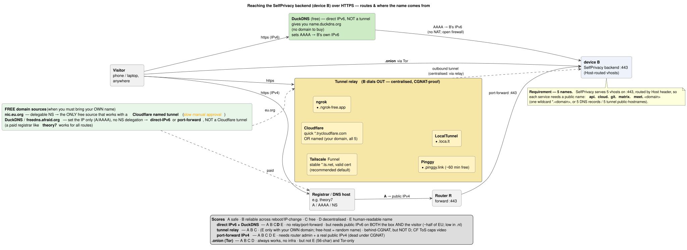
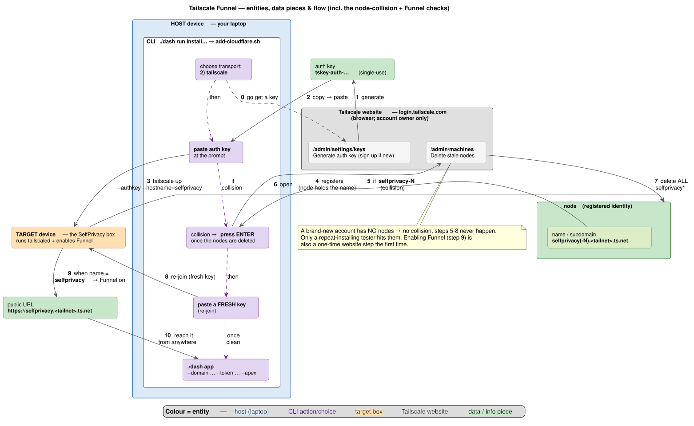
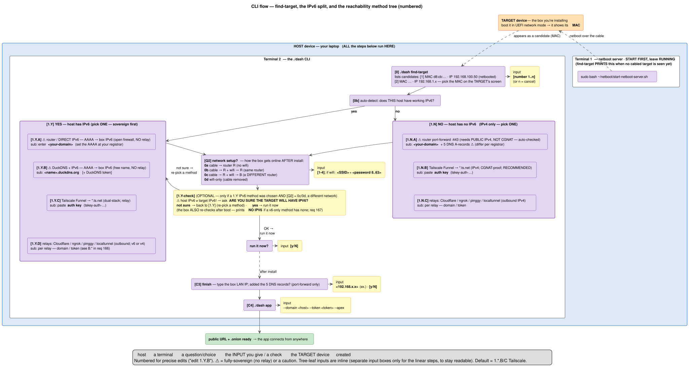

# Setups (`--on`) and reach rows (`--reach` / `--name`) — the setup diagram's views

The test matrix uses the **same axes as the setup diagram** — [`flow.html#setup-map`](flow.html#setup-map), data
`docs/diagrams/setup-map.json`, toggles **Install · Network · Reach · Name** (one diagram view = one combination):

- a **setup** — `./dash run … --on <setup>` — is one **Install × Network** view → a matrix **column**;
- a **reach row** — `--reach <reach> [--name <name>]` plus the transport the app speaks, `--net` — is one
  **Reach × Name** view → a matrix **row group**.

`./dash setups` lists both and checks they still match the diagram (`./dash setups --check` exits 1 when they
don't; the dashboard shows the same check as a banner). Every matrix column/row header has a ▦ link to its diagram
view. Old setup ids still work as aliases and are recorded under the new id.

## Install × Network → setups (`--on`)

| setup (`--on`) | Install | Network (how the server reaches the router after install) | old id | diagram view |
|---|---|---|---|---|
| `cable-0a` | LAN cable | cable→R — its LAN cable goes into your router R | `lan-setup-0a` | [method=cable;net=0a](flow.html#setup-map;method=cable;net=0a) |
| `cable-0b` | LAN cable | cable+wifi→R — cable into R + wifi for the **same** router R | `lan-setup-0b` | [method=cable;net=0b](flow.html#setup-map;method=cable;net=0b) |
| `cable-0d` | LAN cable | wifi-only — cable removed, the server runs on wifi | `lan-setup-0d` | [method=cable;net=0d](flow.html#setup-map;method=cable;net=0d) |
| `cable-0c` | LAN cable | cable→R, wifi→Y — cable into R + wifi for **another** router Y | `lan-setup-0c` | [method=cable;net=0c](flow.html#setup-map;method=cable;net=0c) |
| `wifi-0a` | Wifi | cable→R | `lan-setup-1` | [method=wifi;net=0a](flow.html#setup-map;method=wifi;net=0a) |
| `wifi-0d` | Wifi | wifi-only | `lan-setup-2` | [method=wifi;net=0d](flow.html#setup-map;method=wifi;net=0d) |
| `usb-0a` | USB stick | cable→R | `usb-0a` | [method=usb;net=0a](flow.html#setup-map;method=usb;net=0a) |
| `usb-0d` | USB stick | wifi-only | — (new) | [method=usb;net=0d](flow.html#setup-map;method=usb;net=0d) |
| `usb-0c` | USB stick | cable→R, wifi→Y | `usb-0c` | [method=usb;net=0c](flow.html#setup-map;method=usb;net=0c) |
| `vm` | VM | — (the diagram's VM view has no Network toggle) | `vm-local` | [method=vm](flow.html#setup-map;method=vm) |

Order = the diagram's order. Setups whose server ends up on wifi need a wifi spec on their install, checked in
range by a scan before anything is written: `cable-0b/0d/0c` and `wifi-0d` take `--env WIFI_SSID=<SSID> --env
WIFI_PSK=<PASSWORD>` (the installer writes the wifi config); `usb-0d/0c` take only `--env WIFI_SSID=<SSID>` — the
USB chain writes no wifi config, so set the server's wifi up by hand during the USB install. **Removed** to match the diagram: `usb-0b` (the USB-stick install has no cable+wifi→R view); the
coarse `lan-setup-0` / `usb` / `native-ethernet` ids now need their Network variant. **Harness-only:** `test-vm`
— the throwaway VM the L1/L2 nixosTests start by themselves (not a `--on` value, not a diagram view).

### The four Install methods (`install.<setup>` runs the method's installer for that Network variant)
```
LAN cable  (install.cable-0a … -0c)  netboot over a DIRECT cable, router out of the path (192.168.100.x)
  +----------+  LAN cable  +--------+
  | computer |------------>| server |      then: Network variant (below)
  +----------+             +--------+

Wifi       (install.wifi-0a / -0d)   your computer on router R's wifi; the server netboots THROUGH R
  +----------+  wifi  +----------+       +--------+      NOT runnable yet: needs R configured for network
  | computer |------->| router R |------>| server |      boot; the preflight always refuses (with the setup)
  +----------+        +----------+       +--------+

USB stick  (install.usb-0a / -0d / -0c)  installer USB -> the server's internal disk, no link to your computer
  +-----------+       +--------+
  | USB stick |------>| server |
  +-----------+       +--------+

VM         (install.vm)              VirtualBox VM on THIS computer (build-and-run.sh, built from source)
```

### The Network variants (after install)
| net | the server … | wifi config |
|---|---|---|
| `0a` cable→R | has its LAN cable in your router R (internet via the cable) | none |
| `0b` cable+wifi→R | has its cable in R | + wifi for the **same** router R |
| `0d` wifi-only | has **no** cable — runs on wifi only | wifi that reaches the internet |
| `0c` cable→R, wifi→Y | has its cable in R | + wifi for **another** router Y |

## Reach × Name → reach rows (`--reach` / `--name` / `--net`)

How friends reach the box. The installer applies one route at the end (`reach.<id>` = `tools/add-cloudflare.sh`
over SSH); the L3 flows then drive the app over it.

| reach row | `--reach` | `--name` | `--net` (app) | make it reachable (box) | L3 automated on | diagram view |
|---|---|---|---|---|---|---|
| `onion` | `onion` | – | `tor` | `reach.onion` (nothing to add — every install has its .onion) | box, vm | [reach=onion](flow.html#setup-map;reach=onion) |
| `tailscale` | `tailscale` | – | `https` | `reach.tailscale` | — not yet (one hostname: drive the app, then `./dash report`, below) | [reach=tailscale](flow.html#setup-map;reach=tailscale) |
| `cloudflare-buy` | `cloudflare` | `buy` | `https` | `reach.cloudflare-buy` | box | [reach=cloudflare;name=buy](flow.html#setup-map;reach=cloudflare;name=buy) |
| `cloudflare-trycf` | `cloudflare` | `trycf` | `https` | `reach.cloudflare-trycf` | — not yet (one hostname: drive the app, then `./dash report`, below) | [reach=cloudflare;name=trycf](flow.html#setup-map;reach=cloudflare;name=trycf) |
| `ipv6-buy` | `ipv6` | `buy` | `https` | `reach.ipv6-buy` | box | [reach=ipv6;name=buy](flow.html#setup-map;reach=ipv6;name=buy) |
| `ipv6-duckdns` | `ipv6` | `duckdns` | `https` | `reach.ipv6-duckdns` | box | [reach=ipv6;name=duckdns](flow.html#setup-map;reach=ipv6;name=duckdns) |
| `portfwd-buy` | `portfwd` | `buy` | `https` | `reach.portfwd-buy` | box | [reach=portfwd;name=buy](flow.html#setup-map;reach=portfwd;name=buy) |
| `portfwd-duckdns` | `portfwd` | `duckdns` | `https` | `reach.portfwd-duckdns` | box | [reach=portfwd;name=duckdns](flow.html#setup-map;reach=portfwd;name=duckdns) |
| `onion-chutney` *(harness)* | `onion` | – | `chutney` | — | vm only | (simulates [reach=onion](flow.html#setup-map;method=vm;reach=onion)) |
| `local` *(harness)* | `local` | – | `https` | — | vm only (+ L2's test-vm) | none — https on this computer only |
| `onion-https`, `onion-chutney-https` *(greyed out)* | `onion` | – | `tor+https`, `chutney+https` | — | can't run | none — placeholders from the old matrix, no test |
| `ngrok`, `pinggy`, `localtunnel` *(greyed out)* | same as the id | – | `https` | — (`add-cloudflare.sh --method …` exists) | can't run | none — no diagram option |
| `yggdrasil`, `hyphanet` | — | – | (future) | — | roadmap | none yet |

- **Harness-only rows** exist for testing, not as a way to reach a box: `onion-chutney` = the onion route on a
  private Tor test network on this computer (SOCKS 9009); `local` = https to the VM through a trusted local name
  (theory7 in `/etc/hosts` + Caddy + mkcert CA + SSH tunnel), and L2's self-signed https inside its test VM.
- **One-hostname tunnels** (tailscale, cloudflare trycf) serve the API at the apex only, so there is no automated L3
  over them yet. Drive the app by hand and log the result in that row:
  `./dash app --domain <HOST> --token <API_TOKEN> --apex`, then
  `./dash report L3.connect.desktop --status <pass|fail> --duration <seconds> --on <SETUP> --reach tailscale --net https --ip <BOX_LAN_IP> --key <SSH_KEY>`
  (for trycf: `--reach cloudflare --name trycf`).
- **VM × a public route** (tailscale / cloudflare / ipv6 / portfwd) is a real diagram view but not wired into the
  harness yet (○ in the matrix); `reach.*` apply steps drive a box over SSH.
- **Greyed-out rows** stay in the matrix for reference but can't run (`dash` refuses them, the matrix shows them
  greyed): Tor + https and chutney + https (`onion-https`, `onion-chutney-https`) were placeholders in the old
  matrix with no test and no diagram view; ngrok / pinggy / localtunnel are supported by
  `add-cloudflare.sh --method …` but have no diagram option, so a result would have no view to be filed under.
  Giving one a diagram option (and a test) is what turns it into a normal row.

Fully explicit commands per setup family: [`test_matrix.md`](test_matrix.md); the exact command of any single cell: click it in the matrix (`index.html`).


# Tunneling

After device **B** (the backend) is installed it must be reachable over **https** from the open
internet. The hard part: B usually sits behind NAT (often CGNAT / a third party's router), so there
is no inbound port to forward. The routes, and how each scores on **A** safe / **B** reliable across
reboots+IP-changes / **C** free / **D** non-centralised / **E** human-readable name:


<!-- source: docs/tunneling.puml → rendered to docs/tunneling.svg by docs/render-diagrams.sh (edit the .puml, not the .svg) -->

| route | A | B | C | D | E | grandma-proof? |
|-------|---|---|---|---|---|----------------|
| Cloudflare tunnel + custom domain | ++ hidden origin+WAF | ++ IP-independent | + | -- all traffic via CF; ToS §2.8 caps video/large files | + needs a domain | ~ paste 1 token |
| quick / ngrok / pinggy / localtunnel | + | -- random URL resets | + | -- | -- random host | throwaway only |
| **direct IPv6 + dynamic DNS** | + | ++ AAAA auto-updates | + | ++ just DNS, no relay | + | **+ if ISP gives IPv6** |
| port-forward IPv4 + dynamic DNS | + | + A auto-updates | + | + | + | -- router admin; CGNAT-dead |
| onion (tor) | ++ | ++ | + | ++ | -- 56-char | ~ Tor-only |

Matrix reach rows for these routes: Cloudflare tunnel + custom domain = `cloudflare-buy`; quick tunnel = `cloudflare-trycf` (ngrok / pinggy / localtunnel: greyed-out rows, no diagram view); direct IPv6 = `ipv6-buy` / `ipv6-duckdns`; port-forward = `portfwd-buy` / `portfwd-duckdns`; onion = `onion`; Tailscale Funnel (below) = `tailscale`.

**No single route wins A–E, is grandma-proof, AND reaches every visitor.** Decentralised + reliable
+ no-port-forward is only physically possible **over IPv6** (no NAT to cross). So:

- **Preferred (decentralised):** direct IPv6 — `grandma-1.duckdns.org → AAAA → B:443`, free, human
  readable, survives reboots (dynamic AAAA), cert via Let's Encrypt **DNS-01**, zero router config.
  Only works when B *and* the visitor both have IPv6.
- **Fallback (universal, centralised):** a Cloudflare tunnel — works behind CGNAT for any visitor, at
  the cost of routing through Cloudflare (D) and the media ToS caveat.
- **Always-on default:** onion. Never rely on a relay *you* run (single point of failure + target).

Product direction: **auto-detect and tier** — try direct IPv6, else Cloudflare tunnel, onion always up.

## Free human-readable domain sources
| src | you get | instant? | NS-delegable (→ CF tunnel) | A/AAAA + API (→ IPv6 / port-forward, dynamic DNS, LE DNS-01) |
|-----|---------|----------|----------------------------|-------------------------------------------------------------|
| nic.eu.org | `yourname.eu.org` | no — manual approval, days | yes | yes, once delegated |
| duckdns.org | `grandma-1.duckdns.org` | yes | no | yes (A/AAAA/TXT via token) |
| freedns.afraid.org | `name.mooo.com` etc | yes | no | yes (dynamic update) |

eu.org is the only free source delegable to Cloudflare (tunnel route); DuckDNS/afraid are the free
sources for the IPv6-direct / port-forward routes. See `tools/add-cloudflare.sh` for the implementations.


# Tailscale Funnel — how the box gets its public name

The Tailscale route gives a FREE, CGNAT-proof `https://<name>.ts.net` with a valid cert. The name is not
random: it is **your hostname** (`selfprivacy`) + **your tailnet** (`<tailnet>.ts.net`, fixed to your
account). You create an account, generate a **single-use auth key** (`tskey-auth-…`) and paste it in — that
is the only key needed (an **API key** is only for deleting nodes by script, which we don't do; delete by
hand in the browser). Two one-time, account-level things can block a clean result and the install checks
both before continuing: a **stale node** still owning the `selfprivacy` name (→ you get `selfprivacy-N`), and
**Funnel/HTTPS not yet enabled**. A brand-new user's account is empty, so neither triggers for them — only a
repeat-installing tester hits the stale-node case (delete all `selfprivacy*` at admin/machines).


<!-- source: docs/tailscale.puml → rendered to docs/tailscale.svg by docs/render-diagrams.sh (edit the .puml, not the .svg) -->


# CLI flow — which questions each method asks, and what it creates

The decision the installer walks you through: pick the device, choose how the box is reached from the
internet (default **tailscale**, or `--expert-mode` for the full menu), answer that method's questions,
then install → finish → launch the app. Each public-reachability method is a sub-flow (what you type and
what gets created), composed into one view; same colour key as the Tailscale diagram above (purple = a CLI
step, gray = a website step, orange = on the target box, green = what's created).


<!-- source: docs/cli-flow.puml → rendered to docs/cli-flow.svg by docs/render-diagrams.sh (edit the .puml, not the .svg) -->